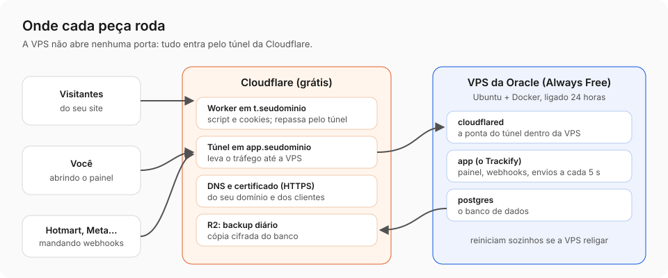

# Cloudflare: domínio, túnel e subdomínio de rastreamento

A Cloudflare fica na frente do Trackify e faz quatro trabalhos, todos no plano grátis:

| Peça | Endereço | Para quê |
|---|---|---|
| **DNS e HTTPS** | o seu domínio | Diz para onde cada endereço aponta e emite o certificado |
| **Túnel** | `app.seudominio.com.br` | Leva você e os webhooks até o painel na Oracle sem abrir porta no servidor |
| **Worker da borda** | `t.seudominio.com.br` | Serve o script, grava o cookie de 400 dias e repassa os eventos ao painel |
| **R2** | (interno) | Guarda o backup diário do banco e os eventos que não chegaram ao painel |



Ordem: parte 1 antes do [guia da Oracle](deploy-oracle.md); parte 2 durante ele; partes 3 e 5 depois que o painel abrir. A parte 4 só é necessária se você atende clientes com domínio próprio.

## Parte 1: colocar o domínio na Cloudflare

1. Entre em **dash.cloudflare.com** → **Add a domain** → digite `seudominio.com.br` → plano **Free**.
2. A Cloudflare copia os registros de DNS que já existem. **Confira se os registros de e-mail (MX) vieram**, senão o e-mail do domínio para de funcionar.
3. Ela mostra **dois nameservers** (ex.: `ana.ns.cloudflare.com` e `bob.ns.cloudflare.com`). Troque os nameservers no lugar onde comprou o domínio:
   - **Registro.br:** entre no painel → clique no domínio → **DNS** → **Alterar servidores DNS** → cole os dois → Salvar.
   - **Hostinger, GoDaddy e outros:** procure **Nameservers** ou **Servidores DNS** nas configurações do domínio.
4. Espere o e-mail "your domain is now active" (normalmente menos de 1 hora; pode levar até 24).
5. Se o seu site já tem certificado na hospedagem, em **SSL/TLS** → **Overview** escolha **Full**. Evita o erro de "redirecionamentos demais".

**Deu certo quando:** o domínio aparece como **Active** no painel da Cloudflare.

## Parte 2: túnel do painel (`app.seudominio`)

O túnel é uma ligação que **sai** do servidor para a Cloudflare. Por isso o servidor não precisa de nenhuma porta aberta.

1. Abra **one.dash.cloudflare.com** (Zero Trust). Na primeira vez, escolha um nome de equipe e o plano **Free**.
2. **Networks** → **Tunnels** → **Create a tunnel** → **Cloudflared** → nome `trackify` → **Save tunnel**.
3. Em "Choose your environment", escolha **Docker**. Aparece um comando com `--token eyJ...`. **Copie só o valor depois de `--token`**: é o `TUNNEL_TOKEN` do `.env` ([guia da Oracle, parte 7](deploy-oracle.md#parte-7-as-configurações-env)). Clique **Next**.
4. Em **Public Hostname**:

   | Campo | Valor |
   |---|---|
   | Subdomain | `app` |
   | Domain | `seudominio.com.br` |
   | Service Type | `HTTP` |
   | URL | `app:8080` |

5. **Save**. A Cloudflare cria o DNS de `app` sozinha.

**Deu certo quando:** depois do `docker compose up` no servidor, o túnel aparece como **Healthy** e `https://app.seudominio.com.br` abre o login do Trackify.

## Parte 3: Worker da borda (`t.seudominio`)

O Worker é um programinha que roda na Cloudflare, no seu domínio. Ele entrega o script, grava os cookies `_rid`, `_fbp` e `_fbc` **como se fosse o seu próprio site** (por isso duram 400 dias, inclusive no Safari) e repassa cada evento ao painel com o segredo `EDGE_SECRET`. Se o painel cair, os eventos ficam guardados no R2.

Faça no seu computador, com o [Node.js](https://nodejs.org) instalado (versão 24) e o projeto baixado:

1. Abra `edge/wrangler.toml` e troque os três endereços pelos seus:
   ```toml
   routes = [
     { pattern = "t.seudominio.com.br", custom_domain = true },
     { pattern = "*/*", zone_name = "seudominio.com.br" },
   ]

   [vars]
   ORIGIN = "https://app.seudominio.com.br"
   ```
2. No terminal, dentro da pasta `edge`:
   ```bash
   npx wrangler login
   npx wrangler r2 bucket create rastro-raw
   npx wrangler r2 bucket lifecycle add rastro-raw expira-30d failed/ --expire-days 30
   npx wrangler secret put EDGE_SECRET
   npx wrangler deploy
   ```
   - O `login` abre o navegador para autorizar.
   - O R2 precisa estar ativado na conta (painel da Cloudflare → **R2**). Pode pedir um cartão; até 10 GB é grátis.
   - No `secret put`, cole **o mesmo** `EDGE_SECRET` do `.env` do servidor.
3. No servidor, confira no `.env` o `EDGE_SECRET` e o `EDGE_URL=https://t.seudominio.com.br`, e reinicie o painel: `docker compose up -d app`.

**Deu certo quando:** `https://t.seudominio.com.br/s.js` mostra um código JavaScript. Depois de colar o script no site, abra uma página com `?fbclid=teste123` no endereço: em **Eventos**, a visita aparece com o selo `fbc`.

## Parte 4: domínio dos clientes (Cloudflare for SaaS)

Só para agência: faz cada cliente ter o próprio `t.dominiodocliente.com.br`, com o certificado emitido pela Cloudflare. Os 100 primeiros domínios são grátis.

1. **Endereço de destino.** No DNS do **seu** domínio, crie:

   | Tipo | Nome | Conteúdo | Proxy |
   |---|---|---|---|
   | AAAA | `edge` | `100::` | ligado (nuvem laranja) |

   É um endereço só para a Cloudflare receber o tráfego; quem responde é o Worker.
2. **Ative o SaaS.** No seu domínio → **SSL/TLS** → **Custom Hostnames** → ative o Cloudflare for SaaS → **Add fallback origin** → `edge.seudominio.com.br`. Espere o status **Active**.
3. **Token da API.** Ícone do perfil → **My Profile** → **API Tokens** → **Create Token** → **Create Custom Token**:
   - Permissions: **Zone** · **SSL and Certificates** · **Edit**.
   - Zone Resources: **Include** · **Specific zone** · o seu domínio.
   - Copie o token (aparece uma vez só).
4. **ID da zona.** Página inicial do seu domínio, coluna da direita: **Zone ID**.
5. No `.env` do servidor:
   ```
   CF_API_TOKEN=o token do passo 3
   CF_ZONE_ID=o ID do passo 4
   CF_SAAS_TARGET=edge.seudominio.com.br
   ```
   e reinicie: `docker compose up -d app`.
6. A rota `*/*` do Worker (já no `wrangler.toml` da parte 3) faz ele responder em todo domínio de cliente.

**O que o cliente faz:** cadastra o domínio em **Primeiros passos** e cria, no DNS dele, um CNAME `t` → `edge.seudominio.com.br` com proxy **desligado** (nuvem cinza). O Trackify registra o domínio na Cloudflare e confere DNS e certificado sozinho a cada 5 minutos.

Sem o passo 5, o Trackify mostra ao cliente o mesmo CNAME e você ativa o domínio à mão em **Custom Hostnames** → **Add Custom Hostname**.

## Parte 5: R2 para o backup

1. Painel da Cloudflare → **R2** → **Create bucket** → nome `rastro-backups`.
2. **R2** → **Manage R2 API Tokens** → **Create API token** → permissão **Object Read & Write**, só no bucket `rastro-backups`.
3. Guarde o **Access Key ID**, o **Secret Access Key** e o **Account ID** (aparece na página do R2). Eles vão no `rclone config` do [guia da Oracle, parte 10](deploy-oracle.md#parte-10-backup-diário-no-r2).

## Por que o subdomínio começa com `t.`?

Porque o Worker usa o `t.` para saber **em qual domínio gravar o cookie**.

- O cookie precisa valer para o site inteiro (`meusite.com.br`), não só para `t.meusite.com.br`. Só assim o script lê o id do visitante em qualquer página e o põe no link do checkout.
- Descobrir sozinho qual parte de um endereço é o domínio principal exige uma lista enorme de exceções (`.com.br`, `.gov.br`, `.co.uk`...), e um erro faria o navegador recusar o cookie. Com a regra fixa ("tira o `t.` do começo"), o Worker nunca erra.
- Uma letra só é curta, neutra e não aparece nas listas de bloqueadores de anúncio. Nomes como `track`, `pixel`, `analytics` ou `stats` costumam ser bloqueados.
- Deixa o passo a passo igual para todo mundo: o CNAME é sempre `t`.

Tecnicamente, qualquer nome de **um nível só** antes do domínio funcionaria (`r.meusite.com.br`, `dados.meusite.com.br`). Para isso, o Worker e a validação do painel teriam que trocar o `t.` fixo por "tira o primeiro nome", e o Worker teria que ser publicado de novo. Se um dia precisar, é uma mudança pequena.

## Deu errado?

| Sintoma | O que fazer |
|---|---|
| Erro **1033** ou **502** em `app.` | O túnel não está ligado ou o serviço está errado. No servidor: `docker compose ps`; no túnel, a URL tem que ser `app:8080` com tipo `HTTP` |
| `t.seudominio.com.br/s.js` dá erro **404** | O `wrangler.toml` está com o domínio de exemplo. Troque e rode `npx wrangler deploy` de novo |
| Eventos não chegam, mas o `s.js` abre | O `EDGE_SECRET` do Worker é diferente do `.env`. Repita o `secret put` com o valor do `.env` e reinicie o app |
| Domínio do cliente parado em "Emitindo SSL" | O CNAME do cliente está com proxy ligado (laranja) ou aponta para outro lugar. Tem que ser cinza e apontar para `edge.seudominio.com.br` |
| Erro **1014** (CNAME Cross-User Banned) | Mesmo caso acima: o cliente também usa Cloudflare e deixou a nuvem laranja |
| O e-mail do domínio parou depois da parte 1 | Faltaram os registros MX. Copie-os do provedor antigo para o DNS da Cloudflare |
