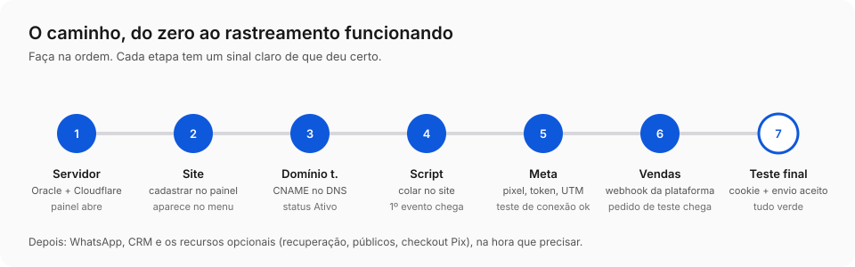

# Guia do iniciante: do zero ao rastreamento funcionando

Para quem nunca configurou rastreamento. Siga na ordem; cada etapa termina com um sinal claro de que deu certo. Tempo total: uma tarde, contando a espera do DNS.



## Antes de começar: o que você precisa ter

- [ ] **Um domínio próprio** (ex.: `meusite.com.br`), com acesso ao lugar onde ele foi comprado (Registro.br, Hostinger, GoDaddy).
- [ ] **Conta na Cloudflare** (grátis) e **conta na Oracle Cloud** (grátis, pede cartão só para verificar).
- [ ] **Business Manager da Meta** com um pixel (conjunto de dados) e a conta de anúncios.
- [ ] **Acesso de administrador** à plataforma de venda (Hotmart, Kiwify, Eduzz, Shopify, WooCommerce ou Stripe).
- [ ] Acesso para editar o site (WordPress, Elementor, Google Tag Manager ou o HTML).

## Onde pegar cada coisa

A tabela que você vai consultar o tempo todo. Os nomes de menu das plataformas mudam de vez em quando; se não achar, procure pela palavra em negrito.

| O que | Onde pegar | Onde colar no Trackify |
|---|---|---|
| **ID do pixel** | Meta: Gerenciador de Eventos → Fontes de dados → seu pixel. É o número embaixo do nome | Primeiros passos → passo 4 |
| **Token da Conversions API** | Gerenciador de Eventos → seu pixel → Configurações → **API de Conversões** → Gerar token de acesso | Primeiros passos → passo 4 |
| **Código de teste da Meta** (opcional) | Gerenciador de Eventos → seu pixel → **Testar eventos** → código `TEST...` | Integrações → 7 · Meta: envio server-side |
| **ID da conta de anúncios** | Gerenciador de Anúncios: o número depois de `act=` no endereço da página (use com `act_` na frente) | Integrações → 6 · Meta Ads |
| **Token de leitura dos anúncios** | Configurações do negócio → Usuários → **Usuários do sistema** → Gerar token, permissão `ads_read`, com a conta de anúncios atribuída | Integrações → 6 · Meta Ads |
| **URL de webhook de vendas** | Já vem pronta no Trackify | Integrações → 2 · Plataformas de venda → cole na plataforma |
| **Hottok da Hotmart** (assinatura) | Hotmart: Ferramentas → **Webhook** → Autenticação | Integrações → 2 · Plataformas de venda → Segredos de assinatura |
| **ID de medição do GA4** (opcional) | Google Analytics: Administrador → **Fluxos de dados** → seu site → `G-...` | Integrações → 8 · GA4 |
| **Segredo do Measurement Protocol** (opcional) | Mesmo fluxo de dados → **Chaves secretas da API do Measurement Protocol** → Criar | Integrações → 8 · GA4 |
| **ID da conta do WhatsApp Business** (opcional) | Gerenciador do WhatsApp → Configurações da conta → **ID da conta** | WhatsApp → Cloud API |
| **Chave secreta do app** (opcional) | developers.facebook.com → seu app → Configurações do app → **Básico** → Chave secreta do aplicativo | WhatsApp → Cloud API |
| **ID do número de telefone** (opcional) | developers.facebook.com → seu app → WhatsApp → **Configuração da API** | WhatsApp → Cloud API |
| **Token de envio do WhatsApp** (opcional) | Usuário do sistema com a permissão `whatsapp_business_messaging` → Gerar token | WhatsApp → Cloud API |

> Token é senha. Cole só no Trackify, nunca em grupo, print ou e-mail.

## Etapa 1: painel no ar

O Trackify roda num servidor seu, ligado 24 horas. Siga o [guia da Oracle](deploy-oracle.md) (servidor grátis) e o [guia da Cloudflare](guia-cloudflare.md) (domínio e túnel).

**Deu certo quando:** você abre `https://app.seudominio.com.br` e entra com o e-mail e a senha que pôs no `.env`.

## Etapa 2: cadastrar o site

1. No menu de baixo, **Sites** → **Novo site**.
2. Preencha: **id** (curto, sem espaço, ex.: `loja`), **nome**, **fuso horário** e **moeda**.
3. Abra o site criado → **Configurações** → em **Domínios do site**, escreva o domínio (ex.: `meusite.com.br`). Assim o Trackify recusa eventos de sites que não são seus.
4. Se paga imposto sobre o faturamento, preencha a porcentagem: ela sai do lucro.

**Deu certo quando:** o site aparece no seletor do topo do menu e o assistente **Primeiros passos** abre com o passo 1 verde.

## Etapa 3: domínio de rastreamento (`t.`)

É o que faz o cookie durar 400 dias, inclusive no iPhone, e o rastreamento passar pelos bloqueadores.

1. **Primeiros passos** → passo 2 → digite o domínio do seu site. Pode digitar só `meusite.com.br`: o `t.` entra sozinho.
2. O Trackify mostra um registro para criar. Vá ao **DNS do seu domínio** (na Cloudflare: seu domínio → **DNS** → **Records** → **Add record**) e crie:

   | Tipo | Nome | Destino | Proxy |
   |---|---|---|---|
   | CNAME | `t` | o destino que o Trackify mostrou | desligado (nuvem cinza) |

3. Volte e clique em **Verificar agora**. A propagação leva de minutos a algumas horas; a tela confere sozinha a cada 5 minutos.

**Deu certo quando:** o passo 2 mostra o selo **Ativo**.

> Se você é o dono da instalação e o domínio é o mesmo do painel, o `t.seudominio` já foi criado pelo Worker no [guia da Cloudflare](guia-cloudflare.md#parte-3-worker-da-borda-tseudominio) e não precisa de CNAME.

## Etapa 4: colar o script no site

1. **Primeiros passos** → passo 3 → copie o código. Ele é assim:
   ```html
   <script defer data-site="loja" src="https://t.meusite.com.br/s.js"></script>
   ```
2. Cole no `<head>` de **todas as páginas**:

   | Onde o site está | Como colar |
   |---|---|
   | WordPress | Plugin **WPCode** (ou "Insert Headers and Footers") → Cabeçalho |
   | Elementor | Elementor → **Código personalizado** → Adicionar novo → local: `<head>` |
   | Google Tag Manager | Nova tag → **HTML personalizado** → acionador **All Pages** → Publicar |
   | Página HTML | Dentro de `<head>...</head>` em cada página |
   | Construtor de página (Hotmart Pages, Greatpages, etc.) | Campo de **scripts no cabeçalho** ou "código de rastreamento" |

3. Abra o seu site numa **aba anônima** (o Trackify ignora `localhost`).

**Deu certo quando:** o passo 3 fica verde com "Primeiro evento recebido" e a visita aparece em **Eventos**.

> **LGPD:** se o site tem banner de cookies, use `data-consent="required"` no script e chame `rastro('consent')` quando a pessoa aceitar. Antes disso, só a contagem anônima.

## Etapa 5: conectar a Meta

### 5.1 Pixel e Conversions API (envio pelo servidor)

1. Pegue o **ID do pixel** e gere o **token da Conversions API** (veja [Onde pegar cada coisa](#onde-pegar-cada-coisa)).
2. **Primeiros passos** → passo 4 → cole os dois → **Salvar** → **Testar conexão**.

**Deu certo quando:** aparece "Pixel conectado". Em **Eventos**, os eventos novos ganham o selo verde da Meta.

> Já usa o pixel no navegador? Mantenha. Para não contar em dobro, use `data-pixel="mirror"` no script e apague a linha `fbq('track','PageView')` do código do pixel: o Trackify repete cada evento no pixel com o mesmo id, e a Meta conta uma vez só.

### 5.2 UTM em todos os anúncios

Sem isso, o Trackify não sabe qual anúncio vendeu. No **Gerenciador de Anúncios**, em cada anúncio → **Rastreamento** → **Parâmetros de URL**, cole:

```
utm_source=FB&utm_campaign={{campaign.name}}|{{campaign.id}}&utm_medium={{adset.name}}|{{adset.id}}&utm_content={{ad.name}}|{{ad.id}}&utm_term={{placement}}
```

Dica: selecione vários anúncios de uma vez e edite em massa.

### 5.3 Gastos dos anúncios (somente leitura)

1. Crie o **usuário do sistema** e o token com `ads_read` (veja a tabela).
2. **Integrações** → **6 · Meta Ads** → ID da conta (`act_...`) e token → Salvar.

**Deu certo quando:** a primeira sincronização traz 30 dias de gasto e a tela **Campanhas** mostra as suas campanhas. Depois disso, atualiza sozinha a cada hora.

## Etapa 6: conectar a plataforma de venda

1. **Integrações** → **2 · Plataformas de venda** → copie a URL da sua plataforma.
2. Cole na plataforma:

   | Plataforma | Onde cadastrar | Eventos para marcar |
   |---|---|---|
   | **Hotmart** | Ferramentas → **Webhook** (versão 2.0) → Cadastrar | Compra aprovada, completa, boleto impresso, atrasada, cancelada, reembolsada, chargeback |
   | **Kiwify** | Apps → **Webhooks** → Criar | Compra aprovada, Pix e boleto gerados, recusada, reembolso, chargeback |
   | **Eduzz** | Área de integrações → **Webhook** | Fatura paga, aberta, cancelada, reembolsada |
   | **Shopify** | Configurações → Notificações → **Webhooks** (formato JSON) | Pagamento do pedido e Atualização do pedido |
   | **WooCommerce** | WooCommerce → Configurações → Avançado → **Webhooks** | Pedido atualizado |
   | **Stripe** | Developers → **Webhooks** → Add endpoint | `checkout.session.completed`, `checkout.session.async_payment_succeeded`, `async_payment_failed`, `charge.refunded`, `charge.dispute.created` |
   | Outra | Use o **webhook personalizado** ou o **Google Sheets** em Integrações | |

3. Recomendado: cadastre o **segredo de assinatura** (Hottok na Hotmart, segredo do webhook nas outras) em **Integrações → 2 · Plataformas de venda → Segredos de assinatura**. Assim ninguém consegue inventar venda.
4. Faça um **pedido de teste** (ou use o botão de teste da plataforma).

**Deu certo quando:** o pedido aparece em **Integrações → Últimos webhooks** e em **Pedidos**. A coluna **Origem** diz se a venda casou com o clique. "Clique (rid)" é o melhor resultado.

## Etapa 7: teste final

1. Abra o seu site numa aba anônima com um clique de teste no endereço:
   `https://meusite.com.br/?utm_source=FB&utm_campaign=Teste|123&fbclid=teste123`
2. Clique no botão de compra e faça um pedido de teste.
3. Volte a **Primeiros passos**.

**Deu certo quando:** o passo 6 mostra as duas linhas verdes: visitante com cookie `_rid` e envios aceitos pela Meta. Em **Eventos**, a sua visita tem o selo `fbc`. Em **Pedidos**, a venda tem origem "Clique (rid)".

Pronto: o rastreamento está completo.

## Depois do básico (quando quiser)

- **WhatsApp:** troque o link `wa.me` do botão por um **link rastreável** (tela WhatsApp). Com a Cloud API oficial, as conversas chegam no Trackify ligadas ao anúncio. Detalhes em [Integrações, seção 7](integracoes.md#7-whatsapp).
- **CRM:** formulários do site viram leads sozinhos. Monte as colunas do seu processo e ligue um evento à coluna "Qualificado" para a Meta aprender quem vira cliente.
- **Recursos opcionais** (Configurações → Recursos): recuperação de boleto e Pix pelo WhatsApp, públicos para remarketing, retenção de vídeo, robô por palavra-chave e checkout com Pix. O que cada um faz está no [manual](manual.md#recursos-que-cada-site-liga-ou-desliga).
- **Equipe e clientes:** convide pessoas em **Equipe** (Dono, Gestor ou Cliente) ou mande o **link público** de tráfego.

## Deu errado? Problemas comuns

| Sintoma | Causa provável | O que fazer |
|---|---|---|
| Passo 3 não fica verde | Script no lugar errado, cache do site ou teste no `localhost` | Confira o script no código-fonte da página (Ctrl+U, procure `s.js`), limpe o cache do WordPress e teste numa aba anônima |
| Domínio fica em "Aguardando DNS" | CNAME com nome errado ou com proxy ligado | Nome é só `t`, destino exatamente o mostrado, nuvem **cinza**. Espere até algumas horas |
| "Testar conexão" da Meta falha | Token de outro pixel ou expirado | Gere um token novo no mesmo pixel do ID informado |
| Webhook com erro 401 | Segredo de assinatura diferente do da plataforma | Copie de novo o segredo da plataforma ou apague o do Trackify para testar |
| Webhook com erro 404 | URL incompleta ou de outra plataforma | Copie de novo a URL da plataforma certa em Integrações |
| Venda com origem "Sem origem" | Link de compra sem `rid` e sem UTM | Confira se o botão de compra é um link (`<a href>`) para o checkout e se o anúncio tem a UTM. Para link que o Trackify não reconhece sozinho, adicione o atributo `data-rastro-rid` |
| Eventos do Safari duram pouco | Site principal fora da Cloudflare | Para os 400 dias no Safari, o site principal também precisa passar pela Cloudflare |

Ainda travado? Abra a tela **Eventos**: ela mostra cada evento, o que foi enviado e a resposta da Meta.
