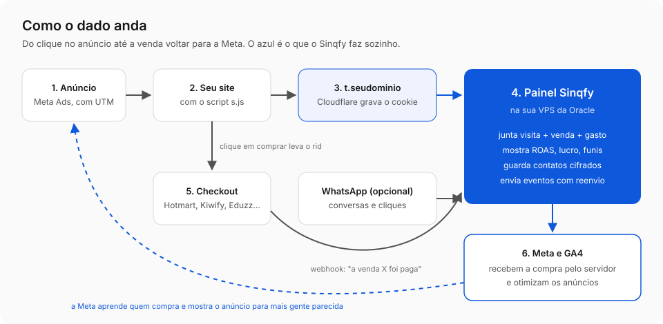

# Manual do Sinqfy

O que o sistema faz, para que serve cada tela e o que significa cada palavra do painel. Para colocar no ar e conectar tudo pela primeira vez, siga o [guia do iniciante](guia-iniciante.md).

## Em uma frase

O Sinqfy junta, num painel só, **quem visitou o seu site**, **quem comprou** e **quanto você gastou em anúncios na Meta**, e devolve as vendas para a Meta pelo servidor, para os anúncios otimizarem com dado real.

1. A pessoa clica no anúncio. O link leva as UTMs (o "RG" da campanha, do conjunto e do anúncio).
2. O site tem o **script** do Sinqfy, que registra a visita e cada ação importante.
3. O script roda no subdomínio `t.` do seu domínio, na Cloudflare. Lá é gravado um cookie que reconhece a pessoa por até 400 dias, inclusive no iPhone.
4. Ao clicar em comprar, o script põe o id da pessoa (`rid`) no link do checkout.
5. A plataforma de venda (Hotmart, Kiwify, Eduzz, Shopify...) avisa o Sinqfy a cada mudança no pedido, por **webhook**.
6. O Sinqfy liga a venda ao clique e manda a compra para a Meta e o GA4 pelo servidor, sem depender do navegador nem de bloqueador de anúncio.

## Palavras que aparecem no painel

| Palavra | O que é |
|---|---|
| **Site** | Um projeto: um domínio, um checkout, uma conta de anúncios. Uma agência pode ter vários |
| **Visitante** | Uma pessoa. Com o domínio `t.` ativo, é reconhecida pelo cookie; sem ele, por um código que muda todo dia |
| **Visita** | Uma sequência de páginas sem pausa maior que 30 minutos |
| **Evento** | Qualquer coisa registrada: página vista, lead, clique em comprar, vídeo assistido |
| **UTM** | Parâmetros no link do anúncio (`utm_campaign`, `utm_medium`, `utm_content`) que dizem de onde a pessoa veio |
| **rid** | O id do visitante que vai no link do checkout e volta no webhook. É o que liga a venda ao clique |
| **Webhook** | Aviso automático que a plataforma de venda manda para o Sinqfy ("o pedido 123 foi pago") |
| **Pixel** | O conjunto de dados da Meta que recebe os eventos. No Sinqfy você usa o ID dele |
| **Conversions API (CAPI)** | O jeito de mandar eventos para a Meta pelo servidor, sem depender do navegador |
| **ROAS** | Faturamento dividido pelo gasto. ROAS 3 = cada R$ 1 em anúncio voltou R$ 3 |
| **Compras (Meta) e ROAS (Meta)** | O que a própria Meta diz que vendeu. Comparar com as vendas reais mostra se ela atribui a mais |
| **Lucro** | Faturamento líquido menos gastos com anúncios e imposto (configurável) |
| **Contato** | Um lead ou comprador no CRM, com nome, e-mail e telefone cifrados |

## O menu, tela por tela

O menu da esquerda muda conforme os recursos ligados no site (veja [Recursos](#recursos-que-cada-site-liga-ou-desliga)) e o seu papel.

### Visão

| Tela | Para que serve | O que você vê |
|---|---|---|
| **Resumo** | Saber em 10 segundos se a operação está dando lucro | Faturamento líquido, gastos, ROAS e lucro do período, comparados com o período anterior; gráfico de faturamento × gastos; vendas por forma de pagamento; vendas por campanha, produto e plataforma |
| **Eventos** | Conferir se o rastreamento está funcionando | Os últimos 100 eventos ao vivo, com os IDs de clique (fbc, fbp, gclid) e o selo de envio para Meta e GA4. Clique no selo para ver a resposta da Meta |

### Vendas

| Tela | Para que serve | O que você vê |
|---|---|---|
| **Campanhas** | Decidir onde pôr ou tirar dinheiro | Cada campanha, conjunto e anúncio com gasto, vendas reais, ROAS real e o que a Meta reporta lado a lado |
| **Pedidos** | Auditar venda a venda | Cada pedido com status (aprovada, pendente, recusada, reembolsada), valor, forma de pagamento e a **origem**: clique (rid), lead, UTM ou sem origem |
| **Checkout Pix** | Vender sem plataforma, com Pix direto na sua chave | Produtos, link de pagamento de cada um, pedidos e o botão "Marcar como pago" (recurso opcional) |
| **Recuperação** | Recuperar boleto e Pix não pagos | Pedidos pendentes na sequência de mensagens do WhatsApp e a configuração da sequência (recurso opcional) |

### Tráfego

| Tela | Para que serve | O que você vê |
|---|---|---|
| **Visão geral** | Entender de onde vem o público | Visitantes, visitas, duração, páginas por visita; fontes, campanhas, páginas, países, dispositivos. Clique em qualquer linha para filtrar a tela toda |
| **Tempo real** | Acompanhar um lançamento ou uma live | Quem está no site nos últimos 5 minutos e a atividade minuto a minuto |
| **Funis** | Descobrir em qual etapa as pessoas desistem | Funis que você monta com páginas (`/checkout`) ou eventos (`evento:Lead`, `evento:video_50`) |
| **Caminhos** | Ver o trajeto real das visitas | As 5 primeiras páginas de cada visita, em fluxo |
| **Comportamento** | Saber se a página é lida e onde clicam | Rolagem (25/50/75/100%) e tempo ativo por página, mapa de cliques por celular e computador, links e botões mais clicados e o retorno em 1, 7 e 30 dias (só visitantes com cookie) |
| **Atribuição** | Comparar quem leva o crédito pela conversão | Primeiro clique contra último clique, por canal e campanha |

### Relacionamento

| Tela | Para que serve | O que você vê |
|---|---|---|
| **CRM** | Acompanhar leads até a venda | Quadro com colunas (Novo, Em conversa, Qualificado, Proposta, Ganhou, Perdeu). Arraste o card; colunas com evento avisam a Meta |
| **Contatos** | Encontrar um lead | Lista com dados mascarados. A ficha mostra os dados completos, a origem e a linha do tempo, e tem o botão de exclusão (LGPD) |
| **Conversas** | Ver o WhatsApp ligado ao anúncio | Conversas da Cloud API, com a origem de cada contato e sugestão de coluna do CRM |
| **Públicos** | Fazer remarketing na Meta | Arquivos CSV em hash de compradores, de quem não pagou e de cada coluna do CRM (recurso opcional) |

### Configurar (só Dono e Gestor)

| Tela | Para que serve |
|---|---|
| **Primeiros passos** | Assistente de 6 passos: domínio, script, Meta, plataforma de venda e teste final. Cada passo fica verde sozinho |
| **Integrações** | Tudo o que conecta: script, URLs de webhook, segredos, webhook personalizado, Google Sheets, Meta Ads, envio para Meta e GA4, últimos webhooks recebidos |
| **WhatsApp** | Links rastreáveis, Cloud API, envio de mensagens e respostas do robô |
| **Configurações** | Nome, fuso, moeda, domínios aceitos, imposto, **Recursos**, link público e exclusão do site |

### Rodapé do menu

- **Sites:** criar e listar os sites da agência (só Dono).
- **Equipe:** convidar pessoas e escolher quais sites cada uma vê (só Dono).
- **Agências:** separar clientes em agências isoladas (só o dono da instalação).
- **Conta:** trocar a sua senha.
- **Tema:** claro ou escuro.

## Recursos que cada site liga ou desliga

Em **Configurações → Recursos**. Desligado, o item some do menu e as tarefas do recurso param.

| Recurso | Vem | O que faz | Precisa de |
|---|---|---|---|
| CRM e contatos | ligado | Quadro, contatos e conversão por coluna | `DATA_KEY` no servidor |
| WhatsApp | ligado | Links rastreáveis, Cloud API e conversas | Para conversas: app da Meta com WhatsApp |
| Retenção de vídeo | desligado | Eventos `video_25` a `video_100` dos vídeos do site, para os funis | Vídeo direto na página (não funciona em vídeo do YouTube embutido) |
| Públicos para remarketing | desligado | CSV em SHA-256 para subir como público na Meta | CRM ligado |
| Recuperação de venda pendente | desligado | Sequência no WhatsApp para boleto e Pix não pagos | WhatsApp ligado, envio configurado e modelos aprovados pela Meta |
| Robô por palavra-chave | desligado | Resposta automática no WhatsApp | WhatsApp ligado e envio configurado |
| Checkout com Pix | desligado | Página de pagamento com Pix na sua chave | `DATA_KEY` no servidor |

## Quem vê o quê

| Papel | Pode |
|---|---|
| **Dono** | Tudo na agência: sites, equipe, integrações, exclusão |
| **Gestor** | Ver e configurar os sites liberados para ele |
| **Cliente** | Só ver os sites liberados, sem mudar nada |

Para mostrar números a quem não tem login, use o **link público** (Configurações): só a visão de tráfego, somente leitura. Vendas nunca ficam públicas.

Usando sozinho no próprio computador, dá para tirar a tela de login com `LOGIN=off` (veja o [README](../README.md#sem-tela-de-login-ferramenta-interna)). No servidor de produção o login continua sempre.

## Privacidade, em linguagem simples

- O Sinqfy **não guarda IP, e-mail nem telefone** de visitante.
- Nome, e-mail e telefone de **contatos e compradores** ficam cifrados. Quem roubar o banco não lê nada sem a chave `DATA_KEY`, que fica fora do banco.
- Para a Meta, e-mail e telefone vão **só em hash** (um código que não dá para desfazer).
- Com `data-consent="required"` no script, nada de cookie ou dado pessoal sai antes do aceite no banner.
- Uma pessoa pode pedir para ser apagada: botão na ficha do contato. Ela não volta a ser cadastrada.

## Onde ler mais

| Quero... | Leia |
|---|---|
| Colocar tudo funcionando do zero | [Guia do iniciante](guia-iniciante.md) |
| Deixar o painel no ar 24 horas na Oracle | [Servidor na Oracle](deploy-oracle.md) |
| Configurar domínio, túnel e subdomínio `t.` | [Cloudflare](guia-cloudflare.md) |
| Detalhe técnico de cada integração | [Integrações](integracoes.md) |
| Como as métricas são calculadas | [Especificação](SPEC.md) |
