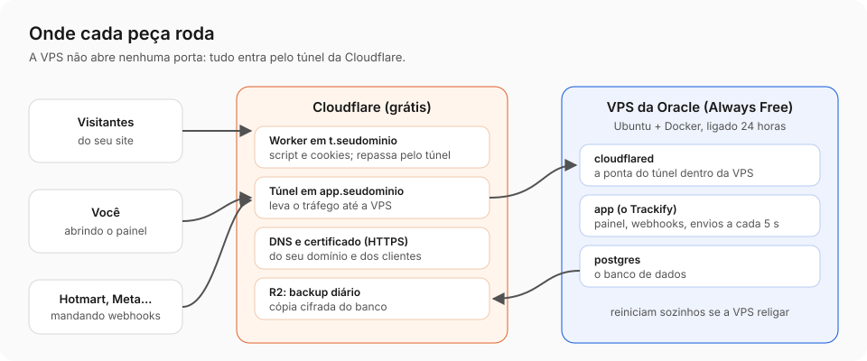

# Do computador para a VPS: o que falta para rodar em produção

Hoje o Trackify roda **neste computador**, no Docker, com túneis rápidos da Cloudflare (`*.trycloudflare.com`). Serve para testar, mas não para valer:

- o painel sai do ar quando o computador desliga ou o Docker para;
- o endereço do túnel muda a cada reinício, e aí o Worker, os webhooks e o script param de achar o painel;
- não há backup na nuvem.

Em produção, o painel fica numa VPS ligada 24 horas, com um endereço fixo no seu domínio. Os passos abaixo usam a Oracle (grátis) e a Cloudflare como exemplo; qualquer VPS com Docker e outro jeito de publicar servem ([Onde hospedar](hospedagem.md)).



## O que você precisa providenciar

| Item | Situação hoje | Como resolver |
|---|---|---|
| Domínio próprio na Cloudflare | A conta da Cloudflare não tem nenhum domínio | Compre ou use um domínio seu e siga a [parte 1 do guia da Cloudflare](guia-cloudflare.md#parte-1-colocar-o-domínio-na-cloudflare) |
| Conta na Oracle Cloud | (a criar) | [Guia da Oracle, parte 1](deploy-oracle.md#parte-1-a-conta-na-oracle) |
| R2 ativado na Cloudflare | Desativado | Painel da Cloudflare → **R2** → ativar (pode pedir cartão; até 10 GB é grátis) |
| 2FA nas contas | (conferir) | GitHub, Cloudflare e Oracle |

## Passo a passo, na ordem

Cada passo aponta para o guia com o detalhe.

1. **Domínio na Cloudflare** e e-mail funcionando depois da troca de nameservers. → [Cloudflare, parte 1](guia-cloudflare.md#parte-1-colocar-o-domínio-na-cloudflare)
2. **VPS da Oracle** criada (Ubuntu 24.04, Ampere A1, 2 OCPU e 12 GB), com Docker. → [Oracle, partes 1 a 4](deploy-oracle.md#parte-1-a-conta-na-oracle)
3. **Projeto na VPS:** `git clone https://github.com/igs-wbr/trackify.git` com um token só de leitura (o repositório é privado). → [Oracle, parte 5](deploy-oracle.md#parte-5-baixar-o-trackify)
4. **Túnel fixo** `app.seudominio` → `app:8080`. Ele substitui o `trycloudflare.com`. → [Cloudflare, parte 2](guia-cloudflare.md#parte-2-túnel-do-painel-appseudominio)
5. **`.env` de produção com segredos novos.** Não reaproveite os do `deploy/.env.local` deste computador. Guarde a `DATA_KEY` num gerenciador de senhas. → [Oracle, parte 7](deploy-oracle.md#parte-7-as-configurações-env)
6. **Subir:** `docker compose up -d --build` e entrar em `https://app.seudominio`. → [Oracle, parte 8](deploy-oracle.md#parte-8-ligar)
7. **Worker apontando para a VPS.** No GitHub (Settings → Secrets and variables → Actions → Variables), troque `TRACKIFY_ORIGIN` para `https://app.seudominio.com.br`. Rode **Actions → Deploy do Worker → Run workflow** e grave o `EDGE_SECRET` novo no Worker (`npx wrangler secret put EDGE_SECRET`). → [Cloudflare, parte 3](guia-cloudflare.md#parte-3-worker-da-borda-tseudominio)
8. **Subdomínio `t.`:** descomente as `routes` no `edge/wrangler.toml` com o seu domínio e faça push; use `EDGE_URL=https://t.seudominio.com.br` no `.env`. → [Cloudflare, parte 3.4](guia-cloudflare.md#34-com-domínio-na-cloudflare-tseudominio)
9. **Backup diário no R2.** → [Oracle, parte 10](deploy-oracle.md#parte-10-backup-diário-no-r2)
10. **Teste de 24 horas:** `sudo reboot` na VPS e conferir que tudo volta sozinho. → [Oracle, parte 9](deploy-oracle.md#parte-9-garantir-que-fica-no-ar-24-horas)
11. **Conectar de verdade:** siga o [guia do iniciante](guia-iniciante.md) no painel novo (site, script, Meta, plataformas de venda).
12. **Desligar o ambiente deste computador** (opcional): `docker stop trackify-app trackify-tunnel trackify-demo trackify-demo-tunnel`. Faça a limpeza do [guia de segurança](seguranca.md#pendente-depende-do-dono-da-conta).

## Levar os dados de teste para a VPS (opcional)

Normalmente a produção começa vazia. Se quiser levar o que já existe aqui:

```bash
# neste computador
docker exec trackify-pg pg_dump -U rastro rastro | gzip > trackify-local.sql.gz
scp -i chave.key trackify-local.sql.gz ubuntu@IP_DA_VPS:~
# na VPS, antes de usar o painel
gunzip -c ~/trackify-local.sql.gz | docker compose exec -T postgres psql -U rastro rastro
```

Os contatos do CRM só abrem se a `DATA_KEY` da VPS for **a mesma** deste computador.

## Custos

| Serviço | Custo |
|---|---|
| VPS Oracle (Always Free, Ampere A1 2 OCPU/12 GB) | R$ 0 dentro do limite gratuito |
| Cloudflare (DNS, túnel, Workers até 100 mil requisições por dia, R2 até 10 GB) | R$ 0 |
| Domínio `.com.br` | cerca de R$ 40 por ano no Registro.br |
| Workers pago (acima de 100 mil eventos por dia) | US$ 5 por mês |
